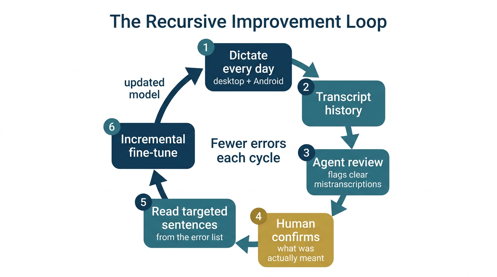
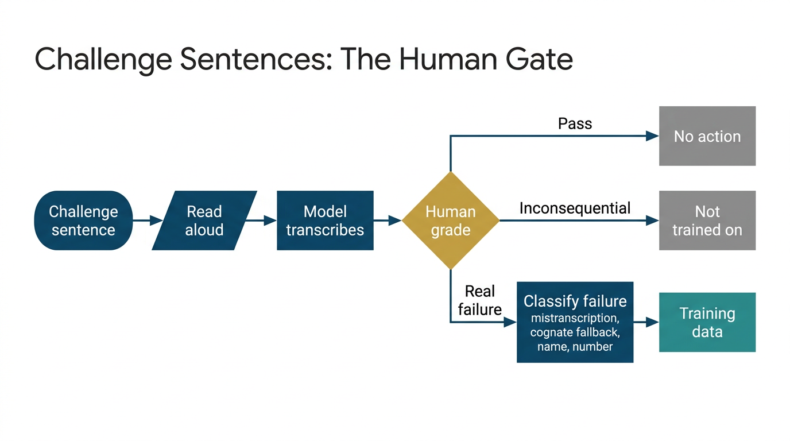

# ASR Recursive Improvement Loop

[](https://github.com/danielrosehill/ASR-Recursive-Improvement-Loop)
[](#method-1-mine-your-own-transcript-history)
[](#the-starting-point)
[](https://huggingface.co/nvidia/parakeet-tdt-0.6b-v2)
[](#use-it-yourself)
[](https://github.com/danielrosehill/ASR-Recursive-Improvement-Loop/releases/latest)
[](pdf/ASR-Recursive-Improvement-Loop.pdf)

**Write-up:** [Improving a personal ASR model by using it every day](https://blog.danielrosehill.com/posts/improve-personal-asr-model-transcript-history-fine-tuning-2o8hdi/)

A playbook for improving a personal speech-to-text model by using it every day and training on what it gets wrong.

It comes from fine-tuning NVIDIA Parakeet for English-Hebrew code-switching, tech vocabulary and a few personal dictation preferences. The results have been encouraging, and the method does not depend on Parakeet or on Hebrew. It needs a model you can retrain, an app that keeps a transcript history, and a person willing to answer a short list of questions.



## The starting point

Before any loop runs, build a baseline the proactive way: list the areas you want the model to handle, write sentences for them, read them aloud and fine-tune in small increments. This gets you a model good enough to use all day. The loop below takes over from there, because real use finds errors you would never have thought to write sentences for.

## Method 1: mine your own transcript history

This is the most powerful part of the process.

1. **Use the model for real.** Dictate through an app running your fine-tune, all day, on every device. In this project that is [Hebrish](https://hebrish.app) on Ubuntu and Android (free, [source on GitHub](https://github.com/Hebrish-ASR/Hebrish-App)).
2. **Keep a transcript history.** The app records each transcript with the model version that produced it.
3. **Let an agent read it.** An agent skill reads everything since the last review, roughly the last 24 hours, and picks out what looks like clear mistranscription.
4. **Confirm with the human.** The agent shows a table of what was heard and what it thinks was meant. You strike or correct rows. Your confirmation is the label, and the agent adds nothing you have not confirmed.
5. **Add to the error list.** Confirmed words go into a small dataset of each word and its wrong forms ([`Hebrish/ASR-Error-List`](https://huggingface.co/datasets/Hebrish/ASR-Error-List), sample in [`samples/`](samples/)).
6. **Record and train.** New sentences containing those words are generated and read aloud, then an incremental fine-tune ships an updated model to the app.
7. **Repeat.** Tomorrow's history shows what is still failing.

The hope is a shrinking list each cycle. It will not shrink in a straight line, because a growing vocabulary brings new failures with it.

Why it works: the errors come from what you actually say rather than from what you guessed you might say, and the review costs minutes because the agent does the reading.

Note that the dictated text and audio are never the training data. The history only tells you which words to work on. The training audio is new sentences recorded on purpose, which keeps private dictation out of any dataset.

## Method 2: challenge sentences with a human gate

The second method tests the model on purpose instead of waiting for failures to come up.



1. The training app serves a challenge sentence.
2. You read it, and the newest model transcribes it.
3. You give it a pass or fail, and classify what failed.
4. Inconsequential failures do not need training. Real ones, such as a mistranscription or a cognate fallback (a Hebrew word turned into an English sound-alike), do.

The record of each attempt holds the audio, the ground-truth sentence, the model's output, the human grade and the failure types ([sample](samples/)). Because the sentence is known in advance, nothing has to be typed and failure rates can be counted per term and per model version.

## Using them together

The two methods cover different gaps. Method 1 finds the unknown unknowns in real speech. Method 2 measures chosen vocabulary and adds a human judgement of which failures matter. Method 1 is the one to start with.

## Lessons for your own loop

- **Train small and often.** Continue from the last weights on new recordings plus a replay set, rather than retraining from the base model. A recent run here took about 18.5 minutes end to end.
- **Mix in replay data.** Old-domain audio in every run limits forgetting.
- **Fix one pattern at a time.** Once vocabulary is strong, take one error pattern, record about 150 sentences for it, train, and check the next day's history.
- **Include contrast sentences.** When fixing a format, also record the neighbouring form that must not change, or the fix overcorrects.
- **Only train what the audio can decide.** If only the speaker's intent separates two forms, training will not fix it.
- **Record the model version on every transcript.** Without it you cannot tell which version fixed what.
- **Hold out a test set.** Keep it term-disjoint from training, and use it for periodic benchmarks, because daily history reading is a hint and not a measurement.

## Current status

As of 2026-11-04 the method is in daily use, and parts of it are still being built. Graded challenge-sentence takes have not been published yet, the human gate records grades but per the project docs does not yet decide what is trained on, failing terms are fed back by hand, and incremental runs publish without an evaluation step. Details are in the [implementation notes](docs/hebrish-implementation.md#known-gaps).

## Use it yourself

This repo is also a Claude Code plugin with one skill, [`asr-recursive-improvement-loop`](skills/asr-recursive-improvement-loop/SKILL.md), which walks an agent through the review for any ASR project:

```text
/plugin marketplace add danielrosehill/ASR-Recursive-Improvement-Loop
/plugin install asr-recursive-improvement-loop@asr-recursive-improvement-loop
```

The skill is a plain Markdown file, so it can also be read by other agents or followed by hand.

## In this repo

| Path | What |
| --- | --- |
| [`docs/hebrish-implementation.md`](docs/hebrish-implementation.md) | How the playbook maps onto the real Hebrish tooling, and its known gaps |
| [`samples/`](samples/) | A few rows of each dataset |
| [`skills/`](skills/) | The agent skill |
| [`pdf/`](pdf/ASR-Recursive-Improvement-Loop.pdf) | The playbook as a PDF, with its Typst source |
| `docs/diagrams/` | The diagrams, generated with Nano Banana 2 |
